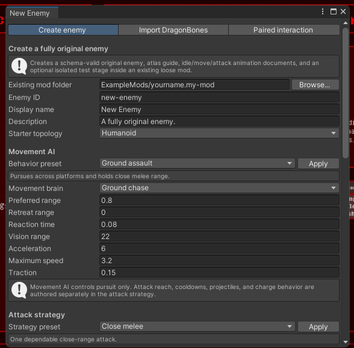

# Enemies

`spawn.inheritTemplateSpawners: true` adds a variant anywhere its Core template already spawns. The optional experimental `spawn.selectionWeight` controls its relative frequency and defaults to `1`. Existing Core choices each have weight `1`; one variant with weight `0.25` therefore has a `0.25 / (1 + 0.25)`, or 20%, share when competing with one matching Core enemy. Multiple variants add their weights to the denominator.

Inherited enemies extend a stable Core enemy ID. They can currently override bounded statistics, inherited attacks, selected behavior modules, drop rules, animation speed, spawning behavior, published rig sprites, and (experimental) any of the template's animation clips, including the player's side of its grab (see [Animating a Core enemy](#animating-a-core-enemy-experimental)).

Only use properties listed for their exact object in the [enemy API reference](../reference/api/enemy.md). Enemy JSON is closed to unknown fields. In particular:

- `spawn` contains `inheritTemplateSpawners`, optional `selectionWeight`, and the optional experimental `joinCoreSpawners` list described under [Fully original enemies](#fully-original-enemies-experimental).
- Original enemies join Core stage spawners only through `spawn.joinCoreSpawners`; otherwise place their content ID in authored stage spawners.
- Only original-enemy attacks and their stages have `ragdollSeconds` (see [Fully original enemies](#fully-original-enemies-experimental)); inherited attack overrides reject it. Tiled interactions have their own, unrelated `ragdollSeconds`.
- Only original-enemy attacks have `missAnimation` (see [Fully original enemies](#fully-original-enemies-experimental)); inherited attack overrides reject it.
- `animation` does not currently have `blendSeconds`.
- A `downedFinisher` uses the documented top-level or per-phase `playerAnimation`/`playerAnimationRef`; it does not have `pairing` or `playerStruggleAnimationRef` fields.

These names may be reasonable future feature requests, but adding them to a document before the schema and runtime implement them invalidates the pack.

The Zombie I LibreSprite kit in `ModSDK/EnemyTemplates/Zombie1` builds a named-layer 128×128 atlas from the exact Core sprites. It inherits `core:enemy/zombie-1`, including the original rig, animation clips, colliders, and specialized prefab behavior.

## Animating a Core enemy (experimental)

There are two ways to give a Core enemy new animation. Both use normalized clips on the Core rig: an `enemyAnimation` whose tracks name that enemy's published bones (its `ModSDK/AnimationReference/NormalizedEnemies/<slug>/rig.json`), and for the player's side of a grab phase a `playerAnimation` on `core:player-rig/alex`.

- **Replace it in the game**: an [asset patch](asset-patches.md#replacing-a-core-enemys-animations-experimental) on `core:enemy/<slug>` with `animations` and `playerAnimations`. Every instance of that enemy plays the new clips.
- **Make a variant**: an inherited enemy (`extends`) maps any of its template's semantic clip names to its own clip with `animationRefs`, and grab phases to the player's side with `playerAnimationRefs`. Only the variant plays them; for a name both give, the variant's own clip wins over a replacement of its template.

```json
{
  "schemaVersion": 1,
  "type": "enemy",
  "id": "your.pack:enemy/zombie-1-tilted",
  "displayName": "Tilted Zombie",
  "extends": "core:enemy/zombie-1",
  "spawn": { "inheritTemplateSpawners": true, "selectionWeight": 0.5 },
  "animationRefs": { "finisher-phase-1": "your.pack:enemy-animation/tilted-phase-1" },
  "playerAnimationRefs": { "finisher-phase-1": "your.pack:player-animation/tilted-phase-1" }
}
```

A variant's `enemyAnimation` sets `enemy` to the variant itself or to its Core template. Keys are the template's semantic names (`idle`, `move`, `attack-primary`, `finisher-phase-N`, and the rest listed in `ModSDK/AnimationReference/CORE-ENEMY-SEMANTICS.md`); an unknown name is the error `core-animation.semantic`, an unknown grab phase `core-animation.phase`, and a track on a bone the rig does not have `core-animation.bone`.

The enemy's Animator still runs it: states, transitions, attack hits and grab steps are unchanged, and the original clips' Unity events still fire. After the Animator each frame, the new clip is sampled at the state's normalized time scaled to its own length (wrapped when it loops, clamped when it does not) and its bones' position, rotation, scale, sprite, sorting order and colour are written over the Animator's pose. Bones and properties it does not animate keep the Animator's pose. A clip may carry cosmetic `sound` and `cameraShake` events and normalized effects, but not `attackHit`, `impulse` or `spriteEffect` (`core-animation.event`); player clips' events are ignored. A clip whose length differs from the original state's by more than 5% gets the warning `core-animation.length` and is stretched to the state's timing.

Packs that animate a Core enemy need a game build with this feature and do not load on 2.2.2.

## Fully original enemies (experimental)

Omit `extends` and use `visual.type: originalSkeletonAtlas` to make an enemy without cloning a Core NPC. The runtime constructs the actor rigidbody and body collider, sprite bones, projectile hit zones, ragdoll joints, attacks, procedural animation set, and reviewed AI from data. A complete example is `ExampleMods/prey-green-zombie/content/original-green-stalker.json`.

The Unity shortcut is **Captivity Reloaded > Modding > Create Original Enemy...**. It can scaffold the enemy, test stage, animation documents, and optional DragonBones project while keeping each result schema-valid.



An original visual requires:

- `regions`: rectangles within one pack-local PNG atlas.
- `bones`: up to 64 named bones. Every bone selects a region and may name a parent. A `hips` bone is required. Make `hips` the single top-level bone: do not retain editor-only wrapper bones such as `root`, an armature name, or `skeleton-*` above it. Every declared bone receives a physics body during ragdoll, so empty wrapper bones can destabilize the chain or pull it away from the floor. Local `x`, `y`, `rotation`, pivot, and sorting order are explicit, so descendants are not limited to the humanoid Core rig.
- `hitZones`: box or circle projectile zones attached to named bones. One zone per bone may use `low`, `normal`, `critical`, or `block` damage. Add practical zones to `hips`, the torso, and major limbs; these trigger hitboxes become solid colliders while the enemy is ragdolled and keep it on platforms.
- `bodyWidth`, `bodyHeight`, and optional body offsets: the solid capsule used for floors and walls while the enemy is standing. It remains separate from the per-bone ragdoll colliders.

After importing from DragonBones, inspect the hierarchy before packaging. `hips` should have no `parent`, all other physical bones should descend from it, and the lower body must have non-zero hit zones. Test at least one temporary knockdown and one death on both a Core stage and any bundled Tiled stage; a rig that stands correctly can still have an invalid ragdoll hierarchy.

`animation.clips` contains named procedural clips. Each clip has an ordered list of frames; a frame supplies an atlas `region`, absolute local position, rotation, or scale values for any subset of bones. Sprite regions switch at the authored frame while transforms interpolate between frames. `idle` and `move` are required. Attack definitions reference another clip by name and specify the exact hit time, total duration, ranges, damage, knockback, chance, and cooldown.

Clips may instead live in separate normalized `enemyAnimation` documents. Map a semantic clip name to its content ID with `animationRefs`, for example `"move": "your.pack:enemy-animation/stalker-move"`. The document's `enemy` must identify the owning enemy. Bone targets are checked against that enemy's declared skeleton (for an inherited enemy, its Core template's rig; see [Animating a Core enemy](#animating-a-core-enemy-experimental)). Numeric tracks support position, rotation, scale, sprite color, and sorting order. Object tracks switch atlas regions by `name`, or load a pack-local PNG directly when the sprite key supplies `asset`. Inline clips and references can be mixed but cannot define the same semantic name. An enemy whose clips all come from `animationRefs` may still give an `animation` object (for `speedMultiplier` or `blendSeconds`) without `clips`.

**Experimental:** `animation.blendSeconds` (0 to 1, default 0) cross-fades an original enemy's bones from the pose they are drawn in into each newly started clip, so switching between idle, move, attack and finisher clips does not snap. Bones the new clip does not animate fade to their rest pose. Events and sprite swaps still start on the new clip's own timeline. A ragdolled enemy gets up from its rest pose without a fade.

Standalone attack delivery types are:

- `melee`: applies an impact inside `hitRange`.
- `hitscan`: verifies range and line of sight and displays the Core tracer.
- `projectile`: launches an atlas-backed Rigidbody2D projectile toward the player's position at the firing moment. It requires `projectileRegion`, `projectileSpeed`, `projectileLifetimeSeconds`, and `projectileRadius`; `projectileGravityScale` defaults to zero. A non-zero gravity scale produces an aim-compensated ballistic arc. Projectiles are destroyed when they hit the player, a platform, or their lifetime expires.
- `area`: applies an impact within `areaRadius` around a facing-relative `offsetX` and local `offsetY` from the enemy.
- `grab`: starts that enemy's `downedFinisher` QTE on a target inside `hitRange`. Consequently, an enemy containing a grab must also define the finisher module. **Experimental:** with several finishers, the attack's optional `finisher` names the one it starts by id; without it the grab picks one by weight (see [Several finishers](#several-finishers-experimental)).
- `multiStage`: consumes 2–16 ordered `stages`, with exactly one ordered `attackHit` animation event per stage. Every stage selects `melee`, `hitscan`, `projectile`, `area`, or `grab` and may override damage, knockback, `ragdollSeconds`, range, offsets, or projectile settings; omitted stage values inherit the containing attack.

**Experimental:** an original attack (or stage) with `ragdollSeconds` (0–30) knocks the player down for that long when it lands, after its damage and knockback, and the knockdown counts as a KO in the status cards and diary. A stage without its own value inherits the attack's; a projectile carries it to its impact. Unlike the `onHitRagdoll` module, which ragdolls on every hit, it applies only to that attack, so a heavy punch can floor the player while jabs only push them back. A downed player is then a valid `downedFinisher` target. A hit that ragdolls the player by itself, a grabbed or dead player, and a player in labor are not knocked down again.

**Experimental:** an original attack can name a `missAnimation`: another of the enemy's clips that takes over when the attack's hit lands on nothing (out of range, out of sight, or a player who cannot be attacked right now, such as while invulnerable: no damage lands, so it counts as a miss). The miss clip starts from the same point in its own timeline that the attack clip had reached at the hit (the `attackHit` event's time, or `hitTimeSeconds`), so a leap that misses carries on into a landing instead of finishing a catch on empty air. Events and effect triggers before that point are skipped. The attack then lasts until the miss clip ends instead of `durationSeconds`, and its cooldown starts. A grab misses when the finisher cannot start; a projectile never misses once it is fired; `multiStage` stages never switch to it. Attacks without `missAnimation` are unchanged.

### Enemy animation events

Non-looping clips referenced by an attack or finisher may contain an ordered `events` track. `attackHit` performs the current attack delivery at that exact point in the animation. Multiple markers repeat a normal delivery; for `multiStage`, they consume the declared stages in order. When at least one `attackHit` marker exists, it replaces the attack's legacy `hitTimeSeconds`; otherwise `hitTimeSeconds` remains the fallback and one of the two timing methods is required. A `cue` is an inert semantic timeline marker with an optional bounded `index` and `amount`; it is available to authoring tools but never invokes a Unity method or gameplay code. Unlike gameplay events, inert cues may also appear on looping clips.

`impulse` applies a bounded physics impulse to the enemy. Its `x` value points forward by default and is mirrored when the enemy faces left; set `relativeToFacing` to `false` to use world-space X.

Presentation events use the same timing track:

- `sound` plays a pack-local WAV or OGG through a positional SFX source. `volume` defaults to `1`.
- `cameraShake` takes a bounded `amount` from `0` through `1`.
- `spriteEffect` briefly displays an existing atlas `region`, optionally attached to a named `bone`. It supports local `x`/`y`, `durationSeconds`, uniform `scale`, and `sortingOrder`.

Enemy-side gameplay events are restricted to attack and finisher clips and cannot be placed on looping clips in this first version. Inert semantic cues are allowed on loops. Player-side finisher events may loop with their player animation. Event audio is loaded safely from the defining pack, capped at 32 MiB per file, and never resolves outside the pack directory.

```json
"swipe": {
  "durationSeconds": 0.55,
  "loop": false,
  "frames": [
    { "time": 0, "bones": { "chest": { "rotation": -12 } } },
    { "time": 0.22, "bones": { "chest": { "rotation": 20 } } }
  ],
  "events": [
    { "time": 0.16, "type": "impulse", "x": 0.35 },
    { "time": 0.22, "type": "attackHit" },
    { "time": 0.22, "type": "cameraShake", "amount": 0.15 },
    { "time": 0.22, "type": "spriteEffect", "region": "hit-flash", "bone": "hand-right", "durationSeconds": 0.08 }
  ]
}
```

The shared scheduler keeps gameplay timing in data without importing arbitrary Unity animation events. `spriteEffect` remains the simple bounded atlas-sprite option; normalized animation documents may additionally define bounded particle, `light`, `trail`, and `decal` effects with timed effect triggers. A presentation effect may reference a safe pack-local PNG in `texture`, divide it with `textureSheetTilesX` and `textureSheetTilesY`, and choose `textureSheetFrame` using top-left row order. Decals require a texture. Light intensity/radius, trail width/persistence, and decal pixels-per-unit have explicit bounded fields. These presentation effects do not add arbitrary damage or script callbacks.

Effect triggers fire their effects at their `time`; an effect's `trigger` and a trigger's `source` are labels that say what the effect shows and where its beat came from. Core exports use the Core names: `trigger` is `thrust`, `cumThrust` or `unique`, `source` is `enemy:Thrust`, `enemy:CumThrust` or `enemy:PlayParticleUnique`, and each effect's `source` is `{ "unityPrefab", "hierarchyPath" }`, the Core prefab it was read from. **Experimental:** a pack's own player clip may name its own: `trigger` is any name of a lowercase letter then letters, digits or hyphens (at most 40), such as `drip` or `sweat`; a trigger's `source` is a label and up to eight beat names joined by `+`, such as `pip:slam` or `pip:slam+cum+overflow`; and an effect drawn by the pack has `"source": { "authoring": "<the file or tool it was made with>" }` instead of a Unity prefab. Validation codes: `player-animation.effect-trigger-name`, `player-animation.effect-trigger-source`, `player-animation.effect-source`.

Reviewed standalone AI types are `groundChase`, `flyingChase`, and `holdPosition`. Chasers face and approach the player, maintain `preferredRange`, and select configured attacks; optional `retreatRange` makes them back away when the player gets too close. Flying chase uses gravity-free two-axis movement. A stationary enemy can still select attacks inside its initiate range. `reactionSeconds` bounds how often each AI makes a new decision. Ground enemies use the stage navigation graph to reach higher platforms through directed `climb` links. When pursuing a player below, they leave the platform and fall naturally instead of climbing downward. Authors should provide links in every direction that an enemy is expected to travel.

Original enemies cannot set `spawn.inheritTemplateSpawners`, because there is no template whose spawn list can be inherited. To appear in Core stages, list the Core enemies whose spawners to join in experimental `spawn.joinCoreSpawners`: each entry names a `core:enemy/...` ID with an optional `selectionWeight` (default `1`, weighed against the spawner's existing weight-1 choices exactly as inherited variants are) and `minimumWave` (default `0`), from which the enemy may be picked there. The enemy joins every stage spawner that offers that Core enemy, wherever it is in the game; a spawner is joined once even if several of its enemies are listed. For example, `[{ "enemy": "core:enemy/abby", "minimumWave": 4 }]` puts an original enemy in Furry Entertainment Robotics' Abby spawners from wave 4. Inherited enemies may use the same field to join spawners beyond their template's. A special wave that keeps a spawner's own roster keeps each joined entry's minimum wave; one that replaces the roster does not include it. A data-driven stage spawner can still reference the enemy's full content ID directly. The format remains experimental while custom rigs receive gameplay testing.

Published behavior modules currently include regeneration, low-health berserk, lifesteal, reflected `thorns` damage, `onHitRagdoll`, `onHitEquipClothing`, content-ID-based `spawnOnDeath`, and periodic `speedPulse` movement bursts. Modules are bounded and composable; inherited attack entries can separately override damage, chance, ranges, timing, knockback, and whether the enemy moves during the attack.

`onHitEquipClothing` gives every successful attack by that enemy a bounded chance to attach a registered Core or mod garment. `cooldownSeconds` prevents repeated attachment attempts. The referenced clothing must be loaded and registered or the enemy definition is rejected.

```json
{
  "type": "onHitEquipClothing",
  "clothing": "your.pack:clothing/hex-band",
  "chance": 0.25,
  "cooldownSeconds": 8
}
```

### Downed-player finisher QTE

Fully original enemies may add an experimental `downedFinisher` behavior module (or several, see [Several finishers](#several-finishers-experimental)). When the enemy is within `triggerRange` of a ragdolled player, or a player voluntarily exposing themself with the normal `Expose` binding (`S` by default), it starts Captivity's struggle meter. Keyboard, controller, and mobile use the same bounded QTE implementation.

```json
{
  "type": "downedFinisher",
  "triggerRange": 1.6,
  "startDelaySeconds": 0.25,
  "durationSeconds": 8,
  "meterMax": 100,
  "inputPower": 14,
  "inputPattern": "adaptive",
  "decayPerSecond": 2,
  "failureDamage": 20,
  "successRecoveryHealth": 8,
  "successStunSeconds": 2.5,
  "cooldownSeconds": 4,
  "animation": "finisher",
  "playerAnimation": {
    "durationSeconds": 0.8,
    "loop": true,
    "frames": [
      { "time": 0, "bones": { "chest": { "rotation": -12 }, "head": { "rotation": 8 } } },
      { "time": 0.4, "bones": { "chest": { "rotation": 12 }, "head": { "rotation": -8 } } },
      { "time": 0.8, "bones": { "chest": { "rotation": -12 }, "head": { "rotation": 8 } } }
    ],
    "events": [
      { "time": 0.4, "type": "libido", "amount": 1 },
      { "time": 0.4, "type": "scaledPleasure", "amount": 0.2 },
      { "time": 0.4, "type": "strengthDamage", "amount": 1 },
      { "time": 0.4, "type": "struggleDamage", "amount": 10 }
    ]
  }
}
```

Reaching `meterMax` releases the player, optionally restores health, and can ragdoll the enemy for `successStunSeconds`. Running out of time releases the player, applies `failureDamage`, and briefly knocks the player down. `animation` references an enemy procedural clip. Optional `playerAnimation` uses the same bounded, interpolated frame format for the published player bones and restores the player's previous pose afterward. Normalized player-animation references also support sprite, color, sorting, and particle presentation tracks.

`inputPattern` selects the struggle interaction and defaults to `adaptive` for compatibility:

- `adaptive` preserves the original behavior: alternating directions on keyboard, right-stick rotation on controller, and aim-stick rotation or Jump taps on mobile. Keyboard players may hold Jump for slower automatic progress.
- `alternate` requires discrete left/right inputs. Controller and mobile sticks must return to neutral between directions.
- `rotate` requires aim-stick rotation on controller/mobile and uses alternating directions as its keyboard fallback.
- `tap` requires repeated presses of the normal Jump action and displays that device's Jump glyph.

A controller or touch-stick rotation completes after roughly three quarters of a circle and grants four times the phase's `inputPower`, matching four successful alternating inputs. Brief crossings through the stick dead zone are tolerated, but releasing the stick for about 0.3 seconds starts a new gesture. Set `decayPerSecond` with that cadence in mind; requiring several complete circles per second is not practical on either device.

On Android, a connected gamepad takes priority after the player uses it, even while the on-screen mobile controls remain visible. The prompt changes to **Circle right stick**; touching the mobile controls switches the active input back to the touch-stick path.

For a reusable curve-based animation, put a `playerAnimation` document in a content root and replace the inline object with `"playerAnimationRef": "your.pack:player-animation/example"`. Normalized position, rotation, and scale tracks are sampled through their authored linear or Hermite curves and converted into the same safe finisher player. A reference may be used on the top-level finisher or an individual phase. Missing IDs invalidate the pack, and an entry cannot define both `playerAnimation` and `playerAnimationRef`. Runtime v1 accepts the `core:player-rig/alex` rig. See `ExampleMods/prey-green-zombie/content/stalker-restraint.player-animation.json`.

For an ordered finisher, replace the single presentation with 2–8 `phases`. Each phase requires a unique `id`, its own `durationSeconds`, and an enemy `animation`; it may also provide a separate `playerAnimation`, `inputPattern`, `inputPower`, and `decayPerSecond`. The struggle meter persists between phases, while the prompt and input gesture may change. Phase animations restart at each transition, and enemy/player events use time relative to that phase. Reaching `meterMax` succeeds immediately; reaching the end of the last phase fails. Combined phase duration is capped at 300 seconds.

**Experimental:** a phase with `"struggle": false` ends the escape window, like a Core grab after the player has lost: the struggle HUD closes, the `succumbed` status card appears, input and meter decay stop, and the remaining phases play out before the failure outcome. Such phases must form one trailing block after at least one struggling phase (`enemy.behavior.finisher-phase-struggle`, `enemy.behavior.finisher-phase-struggle-first`). The HUD timer counts down the struggling phases only. Omitted or `true`, a phase can be struggled out of as before.

#### Riding the player (attachment, experimental)

By default the finisher stands the enemy beside the player. A small enemy that climbs onto the player instead gives the finisher an `attachment`. While it is attached, the runtime carries the enemy's root on a frame on one of the player's bones. That frame is the bone's pivot plus `offsetX`/`offsetY` in the bone's own frame, turning with the bone. The frame's +x is the way the enemy faces and +y is up, in rig units, so enemy clips for attached phases are authored with the root at `rootX`/`rootY` in that frame. From the catch, the root eases from where the enemy was onto that point over `settleSeconds` (0 to 5, default 0.3). `followRotation` (0 to 1, default 1) sets how much the enemy turns with the bone. The usual side-by-side alignment does not run.

```json
"attachment": {
  "target": "spine", "offsetY": 0.27, "rootX": -0.55, "rootY": -0.6, "followRotation": 1, "settleSeconds": 0.3,
  "contacts": [
    { "bone": "hand-left", "x": -0.045, "y": 0.065 },
    { "bone": "foot-left", "target": "hips", "x": -0.16, "y": -0.1 }
  ],
  "sortingOrders": { "foot-left": 36, "head": 25 },
  "playerSortingOrders": { "arm-right-upper": 28 }
}
```

`contacts` keep the ends of limbs on the player whatever either clip does. Each contact names an enemy end bone (`bone`, which needs a parent and a grandparent: hand, lower arm, upper arm). It also gives a point (`x`, `y`, within 20), either in the attachment frame or, with `target`, in the frame of another player bone. After both clips are drawn, two-bone IK turns the end bone's grandparent and parent so the end sits on that point. `angle` also sets the end bone's angle in that frame. `bend` (`1` or `-1`) picks the side the elbow or knee folds to; without it, the joint keeps the side the clip bends it to. `sortingOrders` (enemy bones) and `playerSortingOrders` (player bones) interleave the two actors' sprites while the finisher runs. Valid player bone names are `hips`, `butt`, `spine`, `chest`, `neck`, `head`, `ear`, `face`, and `arm-`/`leg-` `left`/`right` `-upper`/`-lower` with `hand-` and `foot-` `left`/`right`.

Each phase can change what the enemy holds for that phase:

- `contacts` replaces the attachment's contacts while the phase plays. An empty list lets every limb go. A limb that starts or stops holding eases in or out over the phase's `blendSeconds` when set, otherwise over `settleSeconds`. A limb that moves to a new point eases there, and a knee or elbow whose side changes swings across instead of flipping.
- `attached: false` lets go: the root stops following and the contacts ease off. `attached: true` holds on again. Without `attached`, a phase keeps the previous phase's state.

Phases may set `attached` and `contacts` only when the finisher has an `attachment`. When the finisher ends, the enemy is released where its clip last drew it, and physics takes over from there.
**Experimental:** phase changes cut by default. `phaseBlendSeconds` (0 to 2) on the `downedFinisher` cross-fades the player's pose from the pose it is drawn in into each phase's player clip, the first phase included (from the game's own pose). A phase's own `blendSeconds` (0 to 2) sets how long the change into that phase takes, for two poses far apart: the player's pose cross-fades over it instead of `phaseBlendSeconds`, the enemy's clip and any participants' clips cross-fade over it instead of their `animation.blendSeconds`, and attachment/contact changes ease over it instead of `attachment.settleSeconds`. A bone whose pose turns the other way round (its scale flips sign) turns at once instead of shrinking through zero.

**Experimental:** `startFreezeSeconds` (0 to 1) on the `downedFinisher` holds the game still for that long as the grab lands, the beat a Core grab has before it starts. The pause screen keeps control of the time scale, and the freeze ends early if the finisher ends. The default is 0, no freeze.

#### Grab reactions (experimental)

A Core grab does more on each thrust than move the actors: the camera shakes, the screen flushes, the player's mouth opens, a moan may play, and clothing marked to drop on an oral thrust falls off. **Experimental:** a finisher phase can do the same with `reactions`. The phase's clips trigger it with `cue` events, named as the Core exporter names a Core grab's animation events:

| Cue | What happens |
| --- | --- |
| `finisher.thrust` | A thrust. `amount` is the power, 0 to 3, which picks the camera shake (0.15, 0.25, 0.6 or 0.75 for 0.4 seconds). |
| `finisher.cum-thrust` | A cum thrust: a thrust with `cumThrust` added and the cum screen effect. Its shakes are 0.3, 0.5, 0.75 or 1. |
| `audio.player-voice-random` | Rolls `playerVoice`. |
| `audio.enemy-voice-random` | Rolls `enemyVoice`. |
| `audio.unique` | Plays `uniqueSounds[index]`. |
| `finisher.ko` | The player's face goes slack (the KO face and mouth) with the ragdoll screen effect, until the grab ends. |

A cue fires from the finisher enemy's clip or from a participant's, on every loop of a looping clip. In a phase without `reactions`, these cues do nothing, as before.

On every thrust and cum thrust:

1. The player's mouth reacts: the thrust or cum-thrust mouth for the player's pleasure.
2. The player gains libido and pleasure from `thrust.libido` and `thrust.pleasure` (plus `cumThrust`'s on a cum thrust). These use the scale of a Core animation's thrust powers: a thrust gains libido times 10 (through the rule profile's grab libido multiplier) and pleasure times 2, and costs (libido + pleasure) times 5 strength.
3. One of `thrust.sounds` plays, and one of `cumThrust.sounds` on a cum thrust.
4. `playerVoice`, each of `layers` and `enemyVoice` are rolled against their `chance`.
5. The camera shakes and the screen flushes with the player's libido.
6. An `oral` phase drops or destroys the clothing marked to do so on an oral thrust.
7. `struggleDamage` (the sum of the thrust's and the cum thrust's) knocks the struggle meter back and the HUD meter flashes.

A sound set's `chance` runs from 0 to 1 and defaults to 1. A player voice line plays in the player's own voice, so it is silent while the player is muted, and opens their mouth. Every other sound plays at the enemy, at the sound's `volume` (default 1). Sound files are pack-relative WAV or OGG files, up to 32 per list, loaded with the enemy like `sound` event files.

When a phase with `reactions` starts:

- `mutePlayer` mutes the player for the phase. A player who was already muted before the grab stays muted.
- `oral` keeps the player's oral mouth on for the phase.
- `"camera": "enemyHips"` keeps the camera on the enemy's `hips` bone. The default, `player`, follows the player as usual.

A later phase without these settings undoes them. When the grab ends, the player's voice, mouth, face and camera are restored. Once any phase has `reactions`, the player's face also shows the orgasm mouth when they climax during the grab.

```json
{
  "id": "pound",
  "durationSeconds": 6,
  "animation": "finisher-pound",
  "reactions": {
    "camera": "enemyHips",
    "thrust": { "pleasure": 0.1, "libido": 0.1, "struggleDamage": 4, "sounds": ["assets/audio/thrust-1.ogg", "assets/audio/thrust-2.ogg"] },
    "cumThrust": { "pleasure": 0.3, "libido": 0.2, "sounds": ["assets/audio/cum.ogg"] },
    "playerVoice": { "chance": 0.33, "sounds": ["assets/audio/moan-1.ogg", "assets/audio/moan-2.ogg"] },
    "layers": [{ "chance": 0.5, "sounds": ["assets/audio/slap.ogg"] }]
  }
}
```

The phase's clip then carries `{ "time": 0.42, "type": "cue", "cue": "finisher.thrust", "amount": 0 }` where the hips hit their deepest point. Core grabs keep power 2 and 3 for one heavy beat and let the rhythm run at 0.

### Several finishers (experimental)

An original enemy may have more than one `downedFinisher` module, for example a pin on the floor and a carry. Each then needs a unique `id` (a semantic name such as `pin` or `carry`); an enemy with one finisher may leave `id` out, and behaves exactly as before. Every finisher keeps its own phases, animations, ranges, outcomes and statuses. The other module types still appear at most once, and an enemy still has at most 8 modules in all.

- A `grab` attack (or an attack with a `grab` stage) may name the finisher it starts in `finisher`. A grab that does not name one picks among all of the enemy's finishers by `weight`.
- A downed or exposing player: the enemy walks in until it is inside every finisher's `triggerRange`, then picks by `weight` among the finishers whose range reaches the player and whose `startDelaySeconds` has passed. While some finishers cannot start yet, it waits as long as it is still getting closer or one in range is still in its start delay, for at most 3 seconds, then picks among the ones that can.
- `weight` (0.001 to 1000, default 1) is a relative chance: weights 3 and 1 give the first finisher 75%.
- Finishers share one cooldown: after any finisher ends, none of that enemy's finishers starts again until the `cooldownSeconds` of the one that just ended have passed. This keeps an enemy from chaining a second finisher straight after the first.

```json
"attacks": [
  { "id": "tackle", "type": "grab", "finisher": "pin", "animation": "tackle", "chance": 0.6, "damage": 0, "cooldownSeconds": 4, "initiateRange": 1.4, "hitRange": 1.2, "durationSeconds": 0.8, "hitTimeSeconds": 0.4 }
],
"behavior": { "modules": [
  { "type": "downedFinisher", "id": "pin", "weight": 3, "triggerRange": 1.6, "durationSeconds": 8, "meterMax": 100, "inputPower": 14, "animation": "pin" },
  { "type": "downedFinisher", "id": "carry", "weight": 1, "triggerRange": 1.2, "durationSeconds": 10, "meterMax": 100, "inputPower": 12, "animation": "carry" }
] }
```

### Independent NPC participants

A phased `downedFinisher` may reserve up to three real secondary original-enemy instances. Each entry in `participants` defines a stable slot ID, the required enemy content ID, its join policy, ranges, pair offset, facing, and optional fallback animation. Phase-specific animations are selected through `participantAnimations` on each phase.

```json
"participants": [
  {
    "id": "assistant",
    "enemy": "your.pack:enemy/assistant",
    "joinPolicy": "phaseBoundary",
    "joinRange": 3,
    "approachRange": 9,
    "offsetX": 1.25,
    "offsetY": 0,
    "facing": "left",
    "animation": "assist-idle"
  }
]
```

`startOnly` slots are checked when the interaction begins and may be marked `required`. `phaseBoundary` slots are optional: matching unreserved enemies inside `approachRange` approach the active interaction, and enemies inside `joinRange` enter at the next phase boundary. They never jump into the middle of a phase. Runtime v1 limits participants to `originalSkeletonAtlas` enemies because each participant needs the modular animation controller.

While participating, each NPC has its AI, attacks, physics, collisions, animation, facing, position, and sorting state controlled by the QTE session. That state is restored on success, failure, cancellation, component disable, or participant removal. The owner and every secondary NPC are reserved so two active interactions cannot claim the same instance.

Optional `successOutcome` and `failureOutcome` objects replace the legacy fixed outcome fields. They may independently combine `healthDamage`, `strengthDamage`, `pleasure`, `libido`, `healthRecovery`, `enemyStunSeconds`, `playerRagdollSeconds`, and up to eight `equipClothing` content IDs. A common cursed-clothing setup puts `equipClothing` on `failureOutcome`, so the enemy attaches the garment only when the player loses the QTE. When an outcome object is omitted, the existing `successRecoveryHealth`, `successStunSeconds`, or `failureDamage` behavior remains in effect. The Green Stalker example demonstrates two phases with distinct animation/event rates and different success/failure effects.

```json
"failureOutcome": {
  "healthDamage": 10,
  "equipClothing": ["your.pack:clothing/hex-band"]
}
```

`playerAnimation.events` is a separate player-side event track. Each entry controls exactly one effect, and multiple entries may share a timestamp:

- `pleasure` adds its amount directly to the pleasure bar.
- `scaledPleasure` uses the Core libido-scaled pleasure formula.
- `libido` adds its amount to libido.
- `strengthDamage` removes its amount from the yellow strength bar.
- `struggleDamage` removes its amount in points from current QTE progress and cannot lower it below zero.
- `healthDamage` deals its amount as normal player health damage, including active difficulty, rule-profile, and clothing modifiers.

This list is exhaustive. Do not use animation labels such as `hitReaction` as gameplay events. Author the reaction through bone/sprite tracks or a supported presentation effect instead.

Events repeat on every cycle when `loop` is true. The example reproduces the main effects of a normal Zombie thrust at 0.4 seconds in each 0.8-second cycle; its `struggleDamage` is 10 points out of the configured 100-point meter. At most 64 events are allowed and every event time must fall within the clip duration. Positive amounts are required. `pleasure` and `scaledPleasure` are capped at 100 per event, `libido` and `struggleDamage` at 10,000, and damage events at 100,000.

Normalized player documents use the same event names in `name` and place the amount in `floatValue`. The runtime importer now also applies sprite-name tracks when their sprites are available, RGBA color tracks, sorting-order tracks, and bounded particle-effect triggers. Particle targets may name a published player bone or a bone on the paired enemy. The Green Stalker's drain phase uses a Squoid-derived two-trigger particle definition as the initial runtime presentation test.

The optional experimental `statuses` object customizes the existing status cards associated with a finisher. Supported keys are `active`, `mating`, `infusion`, `succumbed`, `orgasm`, `fertilized`, `pregnant`, `implanting`, `labor`, `birth`, and `mindBroken`. Each entry may override `title`, `description`, or both. Omitted entries use Captivity's normal wording. Text supports `{enemy}`, `{fetus}`, and `{child}` placeholders. Cards are connected to their real player events: for example, `active` lasts for the QTE, `orgasm` appears only on orgasm, and pregnancy-related cards appear only if a fetus is actually inserted.

```json
"statuses": {
  "active": { "title": "Pinned", "description": "{enemy} has you pinned!" },
  "succumbed": { "description": "You could not escape {enemy}..." },
  "fertilized": { "description": "{enemy} implanted a {fetus}." }
}
```

Published player bone names are `hips`, `butt`, `spine`, `chest`, `neck`, `head`, `arm-right-upper`, `arm-right-lower`, `hand-right`, `arm-left-upper`, `arm-left-lower`, `hand-left`, `leg-right-upper`, `leg-right-lower`, `foot-right`, `leg-left-upper`, `leg-left-lower`, `foot-left`, `ear`, and `face`.

This module deliberately defines a gameplay finisher rather than pregnancy, clothing, dialogue, or explicit scene behavior; those require separate reviewed modules and assets.
