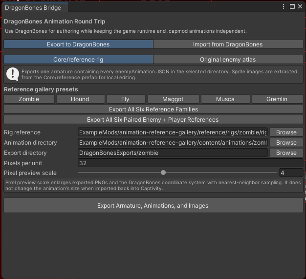
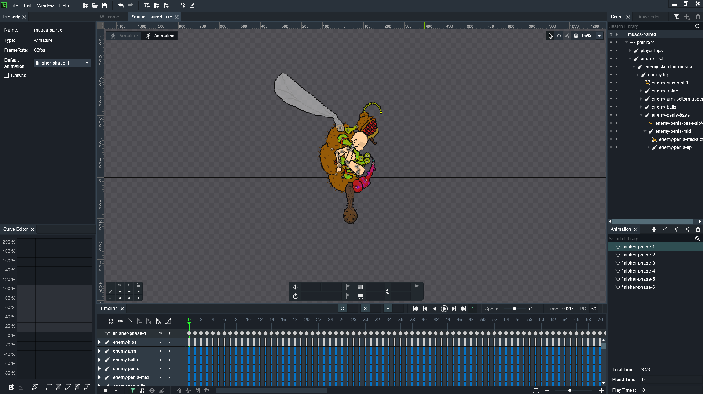
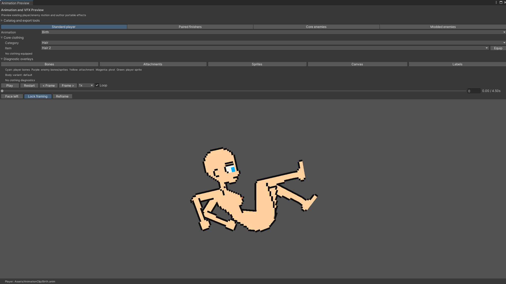

# DragonBones round trip

The DragonBones bridge is an optional animation-authoring tool. Captivity Reloaded does not load the DragonBones runtime and `.capmod` files continue to contain normalized Captivity animation JSON.

## Install DragonBones Pro

The verified Windows installer is retained in the project author's tool bundle, outside the Unity project, at `../Tools/DragonBones/DragonBonesPro-v5.6.3.exe`. Its SHA-256 digest is `593053196DA93BBE9822E2923145F800AFEFEA3DA00E6E9E174FECE0AAF8C796`. A normal source clone may not contain this sibling `Tools` directory; obtain the authoring bundle from the project maintainer rather than downloading an executable from an unverified mirror. The [official DragonBones download page](https://dragonbones.github.io/en/download.html) remains the upstream reference, but this bridge is specifically verified against DragonBones Pro **5.6.3**.

On Windows:

1. Close DragonBones Pro if an older copy is running.
2. Run `DragonBonesPro-v5.6.3.exe` and accept the normal Windows installation prompt.
3. Leave the bundled Adobe AIR support enabled. The default editor path is `C:/Program Files/Egret/DragonBonesPro/DragonBonesPro.exe`.
4. Launch DragonBones Pro and confirm that the displayed version is 5.6.3.
5. Do not install a DragonBones Unity runtime or import a DragonBones `.unitypackage`; Captivity's Unity editor tools exchange JSON and PNG files with the standalone editor.

Only the Windows 5.6.3 workflow is currently verified. For the Unity side of the bridge, follow [Install the authoring tools](installing-authoring-tools.md) and then open the Captivity Reloaded project.

DragonBones files are not imported into the Unity project, game, or `.capmod` runtime.

Open **Captivity Reloaded > Modding > DragonBones Round Trip**. **Core/reference rig** contains presets for the Zombie, Death Hound, Fly, Maggot, Musca, and Gremlin families. A custom reference export needs an `enemyRigReference` JSON, a directory containing animations for one enemy, an output directory, and the rig's pixels-per-unit value.



### Export every Core character

Select **Export Every Core Character to DragonBones** in the round-trip window, or use **Captivity Reloaded > Modding > Export Every Core Character to DragonBones** directly. The command first refreshes the normalized references, then creates DragonBones 5.5 projects for all 21 combat enemies, Betsy, and Alex. Existing enemy projects remain under `DragonBonesExports/core-enemies/<enemy-id>`; Betsy is under `core-enemies/npcs/betsy`, and Alex is under `core-enemies/players/alex`.

`DragonBonesExports/core-enemies/core-character-export-index.json` records each actor's type, ID, armature, skeleton, sidecar, animation count, and image count. A compatibility copy remains at `core-enemy-export-index.json`. Betsy is an authoring reference NPC—not a spawnable combat enemy—and Alex is the player reference. The export stops with an error if a required normalized rig, skeleton, or round-trip sidecar is missing, so a partial batch is never reported as complete.

### Preview a Core rig in the browser

The [Captivity Rig & Animation Player](https://realmsstuff.github.io/Rig-Previewer/) provides a quick browser preview of the Core enemy exports. It reads the Core Enemies bundle generated from the DragonBones export workflow and does not require DragonBones Pro or Unity for playback.

The previewer selects folders, not ZIP archives. Extract the **Core Enemies** ZIP first, then select one individual enemy folder. Do not select the top-level folder containing every enemy, because unrelated images with the same filename can be mixed together.

The selected folder should contain one of the supported skeleton documents and its images:

```text
<enemy-folder>/
  captivity-roundtrip.json
  <enemy>_ske.json
  images/
    <display>.png
```

Either `captivity-roundtrip.json` or the DragonBones `<enemy>_ske.json` can supply the rig. The previewer automatically scans PNG, JPEG, and WebP images in the selected folder tree.

1. Open the [Rig Previewer](https://realmsstuff.github.io/Rig-Previewer/).
2. Select **Select Character Folder**, or drag the extracted enemy folder onto the page.
3. Choose an entry in **Animations** to play it.
4. Use Play/Pause, Reset, Loop, timeline scrubbing, playback speed, preview scale, and wireframe display as needed.
5. Hover a bone in **Bone Hierarchy** to identify it in the preview.

This is a read-only inspection tool. It is useful for checking that the exported rig, sprite assignment, hierarchy, and animation list load before opening the project in DragonBones, but it does not edit the export or replace the Unity round-trip importer.

Choose **Original enemy atlas** for a data-defined enemy. Select its `.enemy.json`, animation directory, and output directory. This mode reads the atlas directly, extracts every declared region with nearest-neighbor scaling, preserves the bone hierarchy and sorting order, and converts each normalized bottom-left pivot into the corresponding centered DragonBones display offset. It does not need a prefab or Unity-imported sprites.

The **Create Original Enemy** wizard can perform this export automatically. Its projects are written outside the loose mod under `DragonBonesProjects/<pack-id>/<enemy-id>` so authoring files and enlarged working images are not included in the `.capmod`.

The exporter creates:

```text
<enemy>_ske.json
captivity-roundtrip.json
images/
  <display>.png
```

The skeleton uses DragonBones data version 5.5. It contains one armature and all animations found in the selected directory. Hermite curves are sampled at the exported frame rate so their visible motion survives the format conversion. Unity's upward Y axis and counter-clockwise rotation are converted to DragonBones coordinates. Animation-safe events appear as `cr.event.*` frame markers and particle triggers appear as `cr.vfx.*` markers.

The default pixel preview scale is 4. Exported images are enlarged with nearest-neighbor sampling and all DragonBones coordinates use the same scale, keeping small pixel sprites clearer in DragonBones without changing their size after round-trip import. Unity's non-centered sprite pivots are baked into display offsets around a conventional centered DragonBones pivot. Import corrected exports into a new DragonBones project; an existing project may retain its previously imported resource transforms.

For a paired interaction, enable **Add a paired enemy + player draft project** in the enemy wizard. It creates matching `paired-draft` enemy and player animation documents and a `<enemy>-paired_ske.json` whose `enemy-*` and `player-*` bones share one playhead. After editing and importing both sides, use the wizard's **Paired interaction** tab to connect the clips to a one- or two-phase finisher. The `enemy-only` subfolder retains the normal idle, move, and attack project.



Import `<enemy>_ske.json` and the PNG files from `images` into DragonBones. Keep bone and animation names intact. When exporting the edited armature, use DragonBones JSON data version **5.5** when available. The bridge accepts JSON skeleton data; do not select binary `.dbbin` output.

Before packaging an original enemy, inspect the converted enemy JSON rather than copying DragonBones' container hierarchy into `visual.bones`. Captivity expects `hips` to be the single top-level physics bone. Remove editor-only parents such as `root`, the armature name, or `skeleton-*`, and reparent `hips` to the top level. Give `hips`, the torso, and major limbs non-zero hit zones: those zones become the solid ragdoll colliders during knockdown. Always test temporary knockdown and death in-game, because the normal standing capsule does not prove that the ragdoll hierarchy is grounded correctly.

For a generated original enemy, return to **Create Original Enemy > Import DragonBones**. Select the loose mod, edited skeleton JSON, and its `captivity-roundtrip.json` or `captivity-paired-roundtrip.json`. **Analyze Only** converts into a temporary directory and reports removed or renamed bones, missing clips, unknown timeline targets, invalid durations, unmapped clips, and lost layer metadata without changing the mod. It also warns when edited `curve`/`tweenEasing`, clockwise rotation directives, or `zOrder` timelines cannot be represented by runtime v1; review those warnings in the pair preview.

**Validate, Back Up, and Import** matches converted animations to existing mod documents by content ID rather than filename. It applies them to a staged copy of the complete mod and runs normal `.capmod` validation before touching the source. If validation succeeds, originals are copied to `ModAuthoringBackups/<pack>/<armature>/<timestamp>` outside the loose mod and the validated files replace them. A failed live validation restores that backup automatically. The importer will not silently create or reconnect an unknown animation ID.

Then open **Paired interaction** in the Original Enemy window. Discovering clips also loads the first two existing phases and their durations. Choose one continuous pair or two named phases, set the struggle and outcome values, and select **Validate and Configure**. Existing phases after phase 2 are preserved by default; replacing the complete phase list requires explicitly disabling preservation. This adds the runtime `downedFinisher` module while preserving unrelated behavior. **Open Pair in Preview** hands the chosen enemy and player documents directly to the existing animation/VFX preview for alignment and effects review.

The DragonBones bridge's lower-level import tab remains available for comparison-directory conversions. Use the original-enemy wizard's import mode when replacing real mod files.

The importer currently round-trips bone position, rotation, and scale timelines. Captivity-only events, effect definitions, effect triggers, source metadata, warnings, and existing sprite/object tracks are preserved from the sidecar. DragonBones event markers are currently visual references; changing their time does not yet change the preserved Captivity event. Slot color, display-switch, and z-order edits are not imported in this first slice.

The editor test suite includes a complete generated-original-enemy round trip. It exports enemy-only and paired projects, modifies a DragonBones transform, safely imports both paired documents, and verifies hierarchy, non-centered pivots, sprite ordering, all required animations, backup creation, and final `.capmod` validation. This is the regression gate for changes to either side of the bridge.

Older `captivityLoongBonesRoundTrip` sidecars remain accepted. They do not need to be regenerated before import.

After import, open **Player Animation Preview** to compare the result and use **VFX Timeline** to edit particle presentation.


